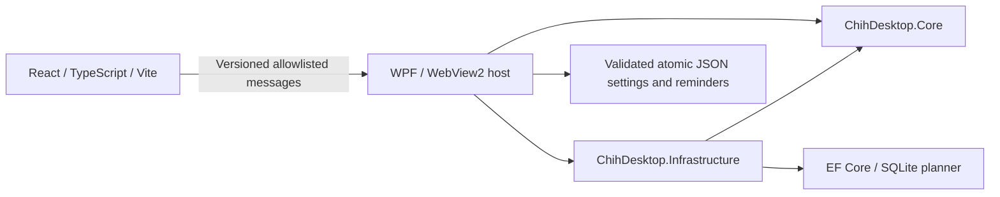

# ChihDesktop

**v0.3.0 · Windows 10/11 · local-first desktop companion and planner**

Chih is a local Windows 10/11 desktop cat: affectionate, lazy, slightly sarcastic, and convinced he is the household manager and a Senior .NET Developer. The existing 15 illustrated transparent PNG frames are preserved. No AI, cloud backend, account, GitHub connection or runtime Docker service is used.

This is a release-preparation working tree, not an installer or a published release. See [the privacy checklist](docs/RELEASE-PRIVACY.md), [manual acceptance](docs/RELEASE-ACCEPTANCE.md) and [the R1 review](docs/R1-REVIEW.md). The owner has authorized the production artwork for the public repository and official releases under separate terms.

## Screenshots

Screenshots are **not yet captured**. Planned: Chih on the desktop, the planner,
and first-run setup, using a disposable profile with synthetic data. Historical
private previews are deliberately not used as screenshots.

## Features

- Transparent animated desktop cat: walk, sit, sleep, stretch and react;
  drag to reposition and use the context menu to control Chih.
- Russian dialogue, gradual moods, petting responses and configurable frequency.
- Local planner with task editing, due dates, priorities, categories,
  Inbox/Today/Upcoming/Completed views and persistent SQLite storage.
- Native reminder management with daily/weekly/app-interval schedules,
  explicit acknowledgment, dismissal, snooze and retained occurrence history.
- Optional owner personalization, modeless onboarding and opt-in per-user autostart.
- Separate light/dark React administration window hosted in WebView2;
  native settings and reminders continue working without WebView2.

## Architecture and stack



Core contains domain rules and application APIs without WPF or EF dependencies.
The desktop composition root uses .NET 10 Hosting/DI; it owns native windows,
sprites, notification presentation, JSON adapters and single-instance lifecycle.
Infrastructure implements planner persistence. React validates contracts with
Zod and delegates business operations to C#; production uses a controlled local
virtual host with no HTTP backend. Tests use xUnit, Vitest and Playwright.

## Privacy

No account, telemetry service, cloud backend or AI API is required. Tasks,
reminders and preferences stay in the current user's local app-data folder.
Clean profiles contain no personal reminders or tasks. Names are optional.
Original photographs, private references, credentials, backups and generated
outputs are excluded from the intended public source. Do not publish a ZIP of
the working directory; audit the staged files and eventual release payload.

## Roadmap and limitations

- Complete disposable-account Windows acceptance and public-source review.
- Later: packaging, signing, prerequisite handling and binary dependency notices.
- Later: broader localization and React reminder/settings management.
- GitHub integration is postponed; its current navigation entry is only a placeholder.

No installer, updater, cloud sync or GitHub API integration is supplied. Russian
is the initial UI/dialogue language. Existing reminder timezone reassignment and
recurrence-kind migration require an explicit future workflow. Mixed-DPI,
sign-in startup and full upgrade/uninstall acceptance still need manual testing.
Native/browser smoke tests do not replace those checks.

## Licensing

Source code and documentation are licensed under [MIT](LICENSE). **The Chih
character artwork is excluded from MIT**, and that code license grants no
permission to redistribute the character artwork separately. See the
[separate artwork license and provenance record](ASSET-LICENSE.md) for the
owner's permission for bundled official distribution and restrictions on other uses.
Third-party dependencies retain their own licenses and copyrights.

## For users

Run ChihDesktop.exe from a complete application distribution with .NET 10 Desktop Runtime available. The planner window additionally needs Microsoft Edge WebView2 Runtime. Native setup, settings and reminders remain available without WebView2. End users do not need Node.js, npm, a .NET SDK, an internet connection or a GitHub account for onboarding.

A clean profile starts with no tasks and no reminder definitions. Onboarding is modeless: Chih remains usable while it is open. It offers welcome, optional name/timezone, behavior/autostart choices, and an optional first reminder. Creating and enabling that reminder requires an explicit checkbox. Closing setup does not complete it; Finish or explicit Skip must be successfully saved. A draft with completion=false is saved for a new profile so restarting after closing setup does not silently complete it.

Right-click Chih:

- **Планировщик Чиха…** opens/activates the separate React/WebView2 task window.
- **Настройки Чиха…** opens native user settings; **Знакомство заново** reopens onboarding without resetting existing records.
- **Напоминания — сегодня** displays pending and completed items.
- **Настроить напоминания…** supports creation, editing titles/times/weekly days/enabled flags, quiet hours, and confirmed deletion of definitions.
- **Test Reminder Now** previews an existing definition; a new empty profile has none to preview.
- Click/pet, drag, Pause, Sleep, Wake Up, Reset Position and Exit retain the existing behavior.

Reminder creation defaults to disabled in the editor. Daily, weekly and active-app interval recurrence are supported. Dismiss and closing a bubble never mean completed. Confirm Done is explicit; snooze is ten minutes. Deleting a definition retains its occurrences, IDs and acknowledgment history, suppresses further delivery and does not recycle historical IDs. Older records remain in JSON; the current native center focuses on today and unresolved items, rather than providing an extensive history browser. Changing a recurrence kind or moving an existing definition to another timezone is deferred; create a new definition and explicitly disable the old one when needed.

## Local storage and compatibility

Data lives under `%LOCALAPPDATA%\ChihDesktop`:

| File/folder | Purpose |
| --- | --- |
| user-settings.json | General preferences, schema version 1 |
| reminders.json | Reminder definitions and occurrence state; versions 1/2 remain readable, new definitions use version 3 |
| chih.db | SQLite planner tasks; unchanged EF schema |
| WebView2 | Dedicated browser profile; only theme preference is kept in web localStorage |

No task, reminder, log, backup, user configuration or original photograph is part of the intended release payload. The illustrated PNGs are embedded resources. Private source references and diagnostic outputs remain local and are excluded; do not distribute a ZIP of the development workspace.

Settings contain optional OwnerDisplayName, Language (currently ru), TimeZoneId, LaunchAtSignIn, StartPetOnly, PetTopmost, pet sizing/movement/frame-rate preferences, ReminderNotificationsEnabled, Personality options, OnboardingCompleted, and SchemaVersion. A new profile detects the Windows timezone, starts pet-only, uses topmost=true and autostart=false, and leaves the name empty. There are no credentials in this schema. User-entered names are treated as literal text; empty names use a generic address. Existing dialogue shuffle bags, moods and cooldowns are retained.

Primary and backup files are validated before use. Compatible backups can be recovered; corrupt bytes are preserved as .invalid-* diagnostics. Unsupported future schemas block writes instead of resetting data. Writes use validated, flushed adjacent temporary files and atomic replacement. Only a validated primary can rotate into backup; corrupt primary bytes cannot destroy a good backup. Settings v0 draft data is normalized in memory only; a permanent .schema-v0-backup is verified before its first saved schema-1 replacement. Correct blocked files/access problems and restart; do not delete data to fix a migration error.

If an existing backup has a future schema, it stays untouched and a separately named .compatible-*.bak preserves the validated current primary before replacement. An invalid permanent compatibility snapshot blocks a write instead of being silently trusted. A blocked reminder profile is not mistaken for an empty install: automatic onboarding/draft creation waits for recovery.

Existing reminder schemas are read without startup rewrites, schedule installation or injected definitions. Their IDs, schedules, last-fired dates, history, snoozes and acknowledgment timestamps remain intact. Before a later legacy reminder write, .pre-v03-backup preserves validated original bytes; ordinary .bak rotation remains protected. Old embedded personality preferences are adopted in memory when no user-settings file exists; once saved, the new settings file is authoritative. Existing saved user settings take precedence over compatibility imports. Legacy beside-executable pet settings are read only for compatibility, never by new-profile configuration. Keep a verified copy of any customized legacy appsettings.json before cleaning/rebuilding old developer outputs.

No reminders are migrated to SQLite. There is no R1 planner schema migration, and no seed task is inserted. Unknown/failing planner migrations preserve the database and leave the planner unavailable rather than deleting or resetting it. Tests use isolated temporary profiles or explicit in-memory stores, never the real user directory.

## Timezone semantics

Legacy reminder files retain Europe/Kyiv scheduling semantics regardless of the Windows display zone. Their existing local dates and UTC due/snooze instants are not reinterpreted.

New definitions bind to the preferred timezone **when created**. Daily/weekly times are wall-clock times in that bound zone, with installed DST rules. During a skipped time, delivery catches up at the first valid minute; repeated hours deduplicate by reminder ID and local date. A weekly occurrence retains its original local date when its definition's weekday is edited. Existing snoozes remain absolute UTC instants.

Changing the preferred timezone affects future definitions and planner Today queries only. It does not retime existing definitions, rewrite occurrence history or clear last-fired dates. Quiet hours and personality's local clock retain the reminder store's base zone, which is shown in the native editor. This conservative R1 rule avoids silent rescheduling and cross-zone duplication. Existing-zone editing needs a separate explicit future migration flow.

Muting reminder notifications does not discard due occurrences. They stay pending and may be delivered after re-enabling; explicit labeled previews remain separate from real occurrences. An unreadable/future user-settings schema pauses automatic notification presentation until configuration can be recovered.

## Autostart

Opt-in autostart uses only the current user's `HKCU\Software\Microsoft\Windows\CurrentVersion\Run` value named ChihDesktop. No administrator access or system-wide registration is required. Repeated saves do not create duplicate entries. Registration failures prevent a successful settings result; failed settings commits attempt to restore the previous registration. Registry and JSON cannot form a single crash-atomic transaction: after a process crash between those operations, check the Windows Startup entry and the stored preference before retrying.

An eventual uninstaller can invoke `ChihDesktop.exe --remove-autostart`. That removes only this registration and leaves user data intact. No installer/uninstaller packaging is implemented in R1. Real sign-in, path quoting, Windows Startup approval and uninstall behavior still require a disposable-account manual test. Automated tests use a mock adapter and do not change the machine's registry.

## Development and verification

Developers need .NET 10 SDK and Node.js 24. Desktop build uses the committed npm lockfile and bundles Vite output into AdminUi. Shipped users need neither development toolchain. On Windows stop this project's Vite process before npm ci, because its native bundler module may be locked.

Use a Windows checkout with the .NET desktop workload available. After the build,
launch the actual desktop host with `dotnet run --project ChihDesktop.csproj`;
open the planner from Chih's context menu. That launch uses your real current-user
profile. Use a disposable Windows account for clean-install acceptance.

There is no Dockerfile, Docker development workflow or Docker runtime dependency.
WPF and native WebView2 testing run on Windows, not in a Linux container.

```powershell
npm --prefix ui/chih-admin ci
dotnet build ChihDesktop.slnx -c Debug
dotnet test ChihDesktop.slnx -c Debug --no-build
dotnet build ChihDesktop.slnx -c Release
dotnet test ChihDesktop.slnx -c Release --no-build
npm --prefix ui/chih-admin test
npm --prefix ui/chih-admin run build
npm --prefix ui/chih-admin run test:browser
```

Chrome browser tests require installed Google Chrome and manage their own loopback dev/preview servers. Optional native smoke verification:

```powershell
dotnet run --project tools/AdminWebViewSmoke/AdminWebViewSmoke.csproj -c Release
```

It uses the real AdminWindow/bridge/SQLite with synthetic tasks and isolated database/browser-profile paths under ignored artifacts. It does not start the real App or access personal reminders/settings/autostart. Normal xUnit onboarding tests construct native controls on STA threads without showing windows.

Browser-only visual development uses `npm --prefix ui/chih-admin run dev`. A persistent DEMO banner identifies in-memory synthetic tasks that reset on reload. Production browser previews have no native bridge and show an expected instruction instead of fake saved tasks. Real WebView2 always uses .NET application services and SQLite; native errors never trigger a mock fallback. Development CSP nonces permit Vite-injected styles and loopback HMR; production keeps a restrictive local-file CSP and no HTTP backend.

The React Settings action opens the same native settings/onboarding window. Reminder editing remains native; a full React reminder/settings editor, broader localization, GitHub integration, installer/signing and release automation are deferred.

The three historical workflow suites still execute 94 persistence/artwork + 65 scheduling + 35 personality assertions. Fixtures are synthetic. Assertions that previously expected automatic installation of a personal schedule now require exact legacy retention and verified pre-write backups. Additional tests cover planner CRUD, bridge isolation, user settings, onboarding, autostart through mocks, timezone transitions and release privacy. Hash tests protect all 15 source PNGs and embedded bytes; they do not execute SpriteBuilder. Legacy asset-generation/alignment utilities are not part of build or runtime and must not be used during R1 verification.
