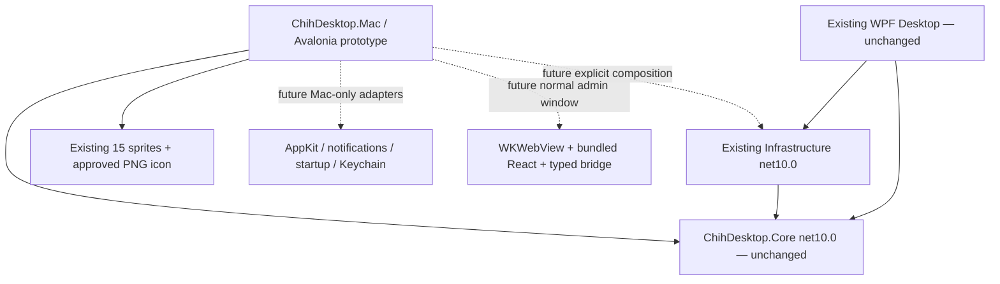

# macOS architecture proposal and isolated prototype

## Repository findings and decision

Inspection preceded implementation. The existing Windows app and its installer
are retained. No existing source, solution, settings, sprite or branding file is
edited for this prototype. The proposal is a separate Avalonia host, not a WPF port.

| Existing path / type | Reuse / platform boundary |
| --- | --- |
| `ChihDesktop.Core/ChihDesktop.Core.csproj` | net10.0; no WPF, Win32 or infrastructure references |
| `ChihDesktop.Core/CatBehaviorService.cs` | Reused directly, including states, direction, pause and weighted behavior |
| Core `PlannerTask`, `PlannerService`, `TaskCompanion`, `ReminderScheduler`, `ReminderCommands`, `PersonalityService`, `DialogueCatalog`, `UserSettingsService` | Platform-independent business logic and interfaces; feasible future reuse, not all wired into this prototype |
| `ChihDesktop.Infrastructure/PlannerDbContext.cs`, `SqlitePlannerTaskStore.cs`, `PlannerDatabaseExecutor.cs` | net10.0 EF SQLite, serialized off-Dispatcher I/O; no direct WPF, registry or user32 calls found |
| `ChihDesktop.Infrastructure/PlannerDatabaseOptions.cs` | Inject a deliberate Mac data path instead of relying on a platform default. Verify native SQLite per architecture before reuse |
| `DesktopComposition.cs`, `App.xaml.cs`, `CatWindow.cs`, native WPF windows | Windows host/lifecycle/presentation; do not reference from the Mac project |
| `AnimationService.cs`, `ChihArtwork.cs`, `AppBranding.cs` | WPF rendering/pack URIs. ChihArtwork mixes clip metadata with WPF vector code; not linked, and Draw is never called |
| `WindowPositionService.cs`, `DesktopActivity.cs`, `ReminderBubble.cs` | user32, HWND, monitor/cursor/window interop and Windows activation handling; replace on Mac |
| `ReminderController.cs` | WPF Dispatcher timers, Windows SystemEvents power events, Windows activity detection, WPF presenter/windows; retain Core scheduling, replace the controller/presentation adapter |
| `WindowsAutostartRegistration.cs`, `SingleInstanceLease.cs`, `app.manifest`, Windows publish/installer files | Registry startup, Windows session/product policy and Windows deployment; not reused blindly |
| `ReminderStore.cs`, `UserSettingsStore.cs` | Located in Desktop but mostly file/JSON logic. Candidates for a later reviewed extraction; Unix atomic-write/recovery/permissions tests required before connecting |
| `Admin/AdminBridge.cs`, `Admin/AdminApplicationApi.cs` | Largely host-neutral protocol/application logic, but physically compiled in Desktop. Extract separately later rather than referencing WPF or duplicating business logic |
| `Admin/AdminWindow.cs`, navigation/resource policies | WebView2 and Windows WebView host integration; Mac needs a different browser adapter |
| `ui/chih-admin/src/bridge.ts`, `runtime.ts` | React UI reusable; native detection and `window.chrome.webview` transport are Windows-specific and need a Mac transport |
| `tests/ChihDesktop.Tests` | Current test project targets net10.0-windows and references WPF; cannot run the complete suite on Mac without a future test-project boundary change |

### Proposed dependencies



The concrete project is `tools/ChihDesktop.Mac/ChihDesktop.Mac.csproj`, named
ChihDesktop.Mac. This keeps the existing WPF `<Compile Remove="tools/**/*.cs">`
boundary intact without modifying Windows project globs. It is deliberately not
added to `ChihDesktop.slnx`; build it explicitly. Moving it to the root later requires
an explicit WPF exclusion or another reviewed build-boundary change.

## Implemented scope

- Avalonia.Desktop and Avalonia.Themes.Fluent pinned to **12.1.4**, compatible with
  net10.0. The desktop package/version was verified against its
  [NuGet listing](https://www.nuget.org/packages/Avalonia.Desktop/12.1.4).
- Small borderless 132×107.25 logical-unit window, requested transparent background,
  topmost by default, with an achieved-transparency diagnostic.
- Existing Core CatBehaviorService reused; six existing clips / exact 15 PNGs
  decoded once. Time-based motion is separate from animation frame rate. Walking
  uses 8 FPS, preserves aspect ratio and mirrors the whole canvas for left-facing.
- Left-click reaction versus thresholded pointer-capture dragging; movement is
  suspended while pressed or while the context menu is open. Capture loss is handled.
- Pause/Resume, Sleep, Wake, Pet, Reset, Topmost and Exit context menu. Commands
  wait for menu closure rather than relying on a background dispatcher race.
- Screen.WorkingArea clamping with negative-coordinate support, render scaling,
  monitor-change handling and current-display walking limits. Dragging can relocate
  the cat to another display; automatic roaming across display seams is not implemented.
- Timer and image resources released on closing. Large elapsed gaps are capped
  to avoid a teleport on resume. No notifications, admin UI, single-instance policy,
  preference persistence or native Spaces shim is claimed implemented.

The six clip descriptors are a tiny local rendering adapter because the existing
metadata owner, ChihArtwork, also depends on WPF. A future shared manifest extraction
may remove that duplication; doing so here would violate the unchanged-Windows scope.
Every embedded frame is checked against the existing approved hash manifest.

The prototype **does not reference Infrastructure or Desktop**, construct a host,
read a user profile, initialize SQLite, migrate a database, register startup, call
an API or access credentials. All its state is in memory. SpriteBuilder is never run.

## macOS behavior research and limits

### Transparency, clicking and focus

Avalonia documents `Transparent` support on macOS and exposes the achieved level;
this is a rendering request, not a verified per-pixel input mask. Its window and
screen APIs distinguish logical window size from screen pixel rectangles.
See [window management](https://docs.avaloniaui.net/docs/app-development/window-management)
and [window how-to](https://docs.avaloniaui.net/docs/how-to/window-how-to).

The prototype uses native small-window bounds, so desktop input outside those
bounds is unaffected. Transparent padding **inside** the rectangle can still
intercept clicks. No claim of alpha-shaped desktop click-through is made. AppKit's
`ignoresMouseEvents` disables input for an entire native window, which would also
break pet dragging unless there is a separate accessible recovery/control path.
Do not implement global mouse hooks or assume an Avalonia hit-test override makes
clicks pass through the OS window. Inspect the actual native handle descriptor;
an NSView must not be blindly cast to NSWindow. Any future shim stays in the Mac host.

Test Metal/compositor transparency, no rectangular shadow/background, pointer
capture, trackpad secondary click and Control-click on real hardware. Normal
appearance or non-Mac Avalonia rendering does not prove macOS correctness.

### Displays, Retina and Spaces

Work-area clamping is implemented using Avalonia Screens, not Win32 monitor math.
Retina/non-Retina transitions, docking/undocking and menu bar/Dock configurations
remain untested. Native macOS screen-coordinate conventions must stay behind the
Avalonia/native adapter; do not mix AppKit point coordinates with pixel positions.

Topmost is not an all-Spaces policy. Keep the current Space by default; evaluate an
opt-in AppKit `NSWindow.collectionBehavior` policy (`canJoinAllSpaces`, appropriate
fullscreen auxiliary behavior) only on a Mac. Newer Stage Manager behavior such as
`canJoinAllApplications` needs availability checks and does not by itself establish
that a window overlays every fullscreen app. An Apple
[Stage Manager collection-behavior reference](https://developer.apple.com/documentation/appkit/nswindow/collectionbehavior-swift.struct/canjoinallapplications)
and [DTS discussion of overlay behavior](https://developer.apple.com/forums/thread/826308)
show why NSPanel/window level and activation matter. This prototype does not force
screen-saver-level overlays, switch Spaces or install untested Objective-C calls.

Keep Dock/application Quit recovery during prototyping; defer `LSUIElement` agent
mode until a reliable native status menu exists. Test Mission Control, app activation,
fullscreen presentations and Stage Manager explicitly; do not steal another app's Space.

Avalonia uses its own Objective-C++ native backend and does not require the .NET
macOS workload for ordinary desktop cross-compilation. Proposed acceptance targets
are macOS 14, 15 and 26, on ARM64 and Intel where supported; that is a **test plan**,
not a compatibility certification. See the current
[Avalonia platform matrix](https://docs.avaloniaui.net/docs/supported-platforms)
and [.NET macOS support matrix](https://learn.microsoft.com/en-us/dotnet/core/install/macos).

## Future platform adapters — proposed, not connected

| Capability | Mac implementation and safeguards |
| --- | --- |
| Pet/bubble positioning and focus | Avalonia presenter plus narrow AppKit adapter where necessary. UI callbacks posted to Dispatcher.UIThread; no native UI types in Core |
| Notifications | UNUserNotificationCenter via Mac-only adapter, explicit permission request and denial handling; route Done/Snooze/Dismiss through existing application commands, never infer acknowledgment from dismissal |
| Sleep/wake, idle/fullscreen | NSWorkspace lifecycle signals and suitable native activity queries; inspect permission requirements, avoid unsolicited Accessibility/Screen Recording requests. Resume uses injected TimeProvider and existing deduplication rules |
| Launch at login | SMAppService for a correctly bundled/signed app, opt-in and per-user, with requires-approval/error states. Existing IAutostartRegistration is command-shaped: review that contract/adapter rather than storing shell commands or pretending registration is synchronous success |
| Preferences | Existing versioned models through IUserSettingsPersistence, with verified atomic backup/recovery and Unix permissions. Proposed separate prototype data root: ~/Library/Application Support/ChihDesktop.MacPrototype; current code writes no such directory |
| Secrets | Keychain-only native adapter if future integrations need secrets; none currently needed. Never put tokens in settings JSON, React localStorage or bridge replies |
| Planner | Reuse IPlannerService / existing Infrastructure after macOS SQLite native-assets and migration tests, with an explicitly injected fresh Mac path. No automatic Windows-profile import or reminder JSON migration |

Relevant Apple APIs: [User Notifications](https://developer.apple.com/documentation/usernotifications),
[SMAppService](https://developer.apple.com/documentation/servicemanagement/smappservice),
[Keychain services](https://developer.apple.com/documentation/security/keychain-services).
These are proposed boundaries, not new Core dependencies. Existing DateOnly due dates,
UTC reminder/snooze instants and reminder IDs must retain their established semantics.

## React administration options

WebView2 does not provide a macOS host. The current React transport cannot simply
be reused unchanged. Preferred spike: a **separate normal Avalonia admin window**
using WKWebView, through the current Avalonia.Controls.WebView offering after package,
license and bridge-capability review. Avalonia's
[web-content documentation](https://docs.avaloniaui.net/docs/app-development/embedding-web-content)
identifies WKWebView as its macOS backend. This package is not added to the prototype.

Alternative: a narrow Mac-native WKWebView host if the packaged control cannot meet
local-resource or messaging requirements. Bundled Chromium would add substantial
size and maintenance; it is not the default recommendation. External browser plus
no backend cannot access local planner services, so must not masquerade as a working
native admin or silently switch to persisted-looking demo data.

Future steps:

1. Extract the host-neutral protocol/application boundary from Desktop in a separate
   reviewed change; reuse Core commands and immutable DTOs, not EF entities.
2. Add a TypeScript native transport adapter for WKScriptMessageHandler messages,
   maintaining protocolVersion, requestId, allowlisted operation/payload validation,
   timeouts, bounded in-flight work, duplicate protection and disposal.
3. Serve only packaged frontend files with a controlled WKURLSchemeHandler or
   constrained file read-access root. No localhost HTTP server. Prove routing/CSP
   and origin handling rather than copying WebView2 virtual-host assumptions.
4. Block unexpected navigation, popups, downloads and permissions. Main-frame and
   origin validation apply to both directions; credentials/native capabilities stay
   outside JavaScript. Retain explicit browser development mode.

Apple describes the native JavaScript message path in
[WKScriptMessageHandler](https://developer.apple.com/documentation/webkit/wkscriptmessagehandler?preferredLanguage=occ)
and custom local resource serving in
[WKWebViewConfiguration](https://developer.apple.com/documentation/webkit/wkwebviewconfiguration?changes=_1).
No React, WebView2 or bridge source file is modified in this phase.

## Build and packaging plan

Build/run/self-test commands are in [the prototype README](../tools/ChihDesktop.Mac/README.md).
Use separate self-contained `osx-arm64` and `osx-x64` publish directories. Do not lipo
together managed executables while forgetting architecture-specific native libraries.
Keep trimming/AOT off for the first spike. Validate each RID on its actual hardware.

Planned Mac-side bundle, after runtime acceptance:

```text
ChihDesktop.app/
  Contents/
    Info.plist
    MacOS/ChihDesktop.Mac        # plus the complete matching-RID publish output
    Resources/chih-icon.icns
```

Info.plist needs a stable owner-approved reverse-DNS bundle identifier,
CFBundleExecutable=ChihDesktop.Mac, name/display name, version/build, icon name,
high-resolution capability and a validated minimum system version. Keep agent-only
mode off initially. Choose the deployment floor against the .NET/Avalonia support
intersection and actual testing, not an unsupported old macOS version.

Use **only Assets/Branding/chih-icon.png** to derive the iconset on a Mac. Its
composition stays unchanged; technical downsampling is not new artwork. Planned
commands (not executed here):

```sh
iconset="artifacts/mac-package/Chih.iconset"
mkdir -p "$iconset"
for size in 16 32 128 256 512; do
  sips -z "$size" "$size" Assets/Branding/chih-icon.png --out "$iconset/icon_${size}x${size}.png"
  twice=$((size * 2))
  sips -z "$twice" "$twice" Assets/Branding/chih-icon.png --out "$iconset/icon_${size}x${size}@2x.png"
done
iconutil -c icns "$iconset" -o artifacts/mac-package/chih-icon.icns
```

Then construct the .app in a fresh artifact directory, copy the full RID payload,
approved derived icon, MIT/artwork notices and dependency licenses, and verify Mach-O
architectures and executable bits. Perform Developer ID signing with appropriate
minimal .NET JIT entitlements, sign nested native code before the bundle, verify,
notarize and staple before external distribution. Do not use blanket deep-signing or
disable Gatekeeper. See [Avalonia deployment guidance](https://docs.avaloniaui.net/docs/deployment/macos).

After that, use hdiutil on a Mac to make a per-architecture DMG with the .app and
Applications shortcut, then validate/sign/notarize/staple as appropriate and generate
checksums. No .app, .icns, DMG, signing identity, Keychain credential, notarization
request, installer modification or publication is created by this prototype.

## Actual results and required Mac acceptance

This implementation environment is Windows x64 with .NET SDK 10.0.401. It can
compile Avalonia desktop code and cross-publish raw Mac payloads, but cannot launch
AppKit/macOS native binaries. **No macOS graphical runtime behavior is verified.**

Required on an actual Mac (all NOT RUN):

- Transparent compositor output and lack of rectangle/shadow around actual sprites.
- Click versus drag, capture loss, secondary/Control-click, exit via menu and Dock.
- All six states, four-frame 8-FPS walk, whole-canvas flip and preserved paw baseline.
- Retina/non-Retina monitors, negative layouts, display removal, Dock/menu bar work
  area changes, desktop scaling and screen sharing configurations.
- Current Space/Mission Control/Stage Manager/fullscreen activation and non-focus-stealing
  behavior; define explicit opt-in policy before implementing an all-Spaces shim.
- Sleep/resume without movement jumps; timer/resource cleanup; battery/idle CPU.
- Real ARM64 and Intel launch, native-library loading, bundled Dock icon, Gatekeeper,
  signatures and .app/.dmg installation in a disposable account.
- Before connecting persistence: Mac SQLite/recovery/permissions and synthetic profile
  tests. Before connecting React: actual WKWebView local origin, bridge and security tests.

Current implementation changes are limited to new files under tools/ChihDesktop.Mac
and this document. The Windows app, Windows solution, Core, Infrastructure, React,
installer and all approved artwork are intended to remain byte-identical; a source
snapshot comparison and final verification results are recorded separately below.

### Executed results (2026-11-01)

| Check | Actual result |
| --- | --- |
| Prototype Debug build | Passed, zero warnings/errors |
| Prototype Release build | Passed, zero warnings/errors |
| `--self-test`, Debug and Release | 6,055 assertions passed in each; includes 6,000 frame-bound iterations, not 6,055 separate test cases |
| Self-contained `osx-arm64` publish | Passed; raw local folder produced |
| Self-contained `osx-x64` publish | Passed; raw local folder produced |
| Mach-O validation | Correct target CPU in each app host and CoreCLR; native Avalonia/Skia files present |
| Existing Windows regression suite | 214 passed, zero failed/skipped, Release `--no-build --no-restore`; WPF/installer not rebuilt |
| Source-preservation snapshot | All 151 pre-existing tracked/unignored files match their before hashes |
| Artwork | All 15 source sprites unchanged; Debug/Release embedded resources match approved baseline; approved branding source unchanged |
| macOS UI / Spaces / input | NOT RUN — no Mac runtime in this Windows environment |
| `.app` / `.icns` / `.dmg` / signing / notarization | Planned only, NOT RUN |

Local raw output directories are `artifacts/mac-prototype/osx-arm64` and
`artifacts/mac-prototype/osx-x64`. They are not signed, user-ready Mac installers.
The source project remains independent of those generated files. Build, diagnostic
and architecture-validation logs are under `artifacts/mac-prototype/` and ignored
by Git. No existing user profile was opened, imported, migrated or reset.

New source files only:

- `tools/ChihDesktop.Mac/ChihDesktop.Mac.csproj`
- `tools/ChihDesktop.Mac/Program.cs`
- `tools/ChihDesktop.Mac/MacPetWindow.cs`
- `tools/ChihDesktop.Mac/PrototypeModel.cs`
- `tools/ChihDesktop.Mac/PrototypeChecks.cs`
- `tools/ChihDesktop.Mac/README.md` and `.gitignore`
- `docs/MACOS-PROTOTYPE.md`

No commits, pushes, installer changes, SpriteBuilder execution or releases were made.
The next safe step is Mac hardware acceptance of this in-memory overlay before any
planner, reminder persistence, native service or React-host integration is connected.
